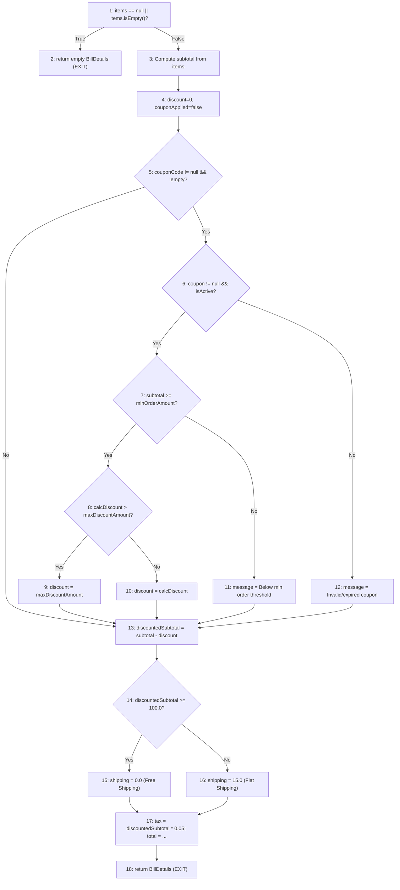

# Automated Web Application Testing Using Selenium WebDriver, JUnit 5 and Formal QA Techniques

**Course**: Software Testing & Quality Assurance (CA3)  
**Category**: Category 2 – End-to-End Web Application Automation  
**Team Number**: 17  
**Team Members**:
- **Adarsh I L**
- **Chandan**

---

## 1. Project Overview & Objectives

This academic project delivers a complete, executable e-commerce web platform ("ApexTech Store") along with a rigorous test automation and quality assurance engineering framework.

The automation suite demonstrates formal Black-Box and White-Box testing techniques using:
1. **Black-Box Testing**:
   - **Equivalence Class Partitioning (ECP)**: Input domain analysis for credentials, product quantities, coupons, and address fields.
   - **Boundary Value Analysis (BVA)**: 7-point boundary evaluation ($\text{Min}-1, \text{Min}, \text{Min}+1, \text{Nominal}, \text{Max}-1, \text{Max}, \text{Max}+1$) using JUnit 5 Parameterized Tests.
2. **White-Box Testing**:
   - Control Flow Graph (CFG) construction on the complex billing calculation business logic (`CartCalculationService.calculateBillDetails`).
   - Formal mathematical derivation of Cyclomatic Complexity ($V(G) = 7$).
   - Basis Path Testing deriving 7 linearly independent execution paths with 100% decision and statement coverage.
3. **End-to-End Functional Automation**:
   - Complete implementation of the **Page Object Model (POM)** design pattern.
   - 15 comprehensive automated test scenarios (TC01 to TC15) executed in Google Chrome using Selenium WebDriver.
   - Automated screenshot capture for every test run and automated Maven Surefire HTML reporting.

---

## 2. Technology Stack

- **Programming Language**: Java 17 (Amazon Corretto OpenJDK 17 LTS)
- **Web Framework**: Spring Boot 3.2.3 (Spring Web, Spring Data JPA, Embedded Tomcat)
- **Database**: H2 In-Memory Relational Database (`jdbc:h2:mem:ecommercedb`)
- **Frontend**: HTML5, CSS3, JavaScript (Vanilla ES6, responsive, mobile-ready)
- **Automation Tool**: Selenium WebDriver 4.18.1
- **Testing Framework**: JUnit 5 Jupiter 5.10.2 (`junit-jupiter-api`, `junit-jupiter-params`, `junit-jupiter-engine`)
- **Driver Management**: Boni Garcia WebDriverManager 5.7.0
- **Build & Dependency Management**: Apache Maven 3.9.6
- **Target Browser**: Google Chrome (Chrome Headless new mode)
- **IDE Compatibility**: Eclipse IDE & VS Code (Maven project standard)

---

## 3. Project Architecture

The project follows a standard Maven multi-tier architecture separating application code, presentation resources, page objects, and test classes:

```
ecommerce-automation/
├── pom.xml                                  # Maven project object model & dependencies
├── README.md                                # Master project documentation
├── .gitignore                               # Git exclusion rules
├── presentation/                            # Academic presentation folder
│   └── Team17_CA3_Final_Presentation.pptx   # Editable 11-slide PowerPoint presentation
├── docs/                                    # Documentation directory
│   ├── ARCHITECTURE.md                      # System architecture & sequence diagrams
│   ├── TESTING_REPORT.md                    # Formal QA matrices, CFG, & execution logs
│   ├── PRESENTATION_SLIDES.md               # 11-slide presentation text & transcript
│   ├── reports/                             # Permanent HTML test execution reports
│   │   └── surefire-report.html             # Maven Surefire HTML report
│   └── screenshots/                         # 15 genuine Selenium viewport PNG captures
├── src/
│   ├── main/
│   │   ├── java/com/team17/ecommerce/
│   │   │   ├── EcommerceApplication.java    # Spring Boot application entry point
│   │   │   ├── controller/                  # REST & Web page controllers
│   │   │   │   ├── AuthApiController.java   # Auth endpoints (/api/auth/*)
│   │   │   │   ├── CartApiController.java   # Cart calculation (/api/cart/*)
│   │   │   │   ├── OrderApiController.java  # Order checkout (/api/orders/*)
│   │   │   │   ├── ProductApiController.java# Product catalog (/api/products/*)
│   │   │   │   └── WebPageController.java   # View forwards (/, /cart, /checkout, etc.)
│   │   │   ├── model/                       # Data models & DTOs
│   │   │   │   ├── BillDetails.java         # Calculation breakdown model
│   │   │   │   ├── CartItem.java            # Shopping cart item
│   │   │   │   ├── CheckoutRequest.java     # Checkout submission payload
│   │   │   │   ├── DiscountCoupon.java      # Coupon business rules
│   │   │   │   ├── Order.java               # Persisted order entity
│   │   │   │   ├── Product.java             # Catalog item entity
│   │   │   │   └── User.java                # Registered customer entity
│   │   │   └── service/                     # Business logic services
│   │   │       ├── CartCalculationService.java # Target method for White-Box testing
│   │   │       ├── CheckoutService.java     # Address validation & checkout processing
│   │   │       ├── ProductService.java      # Product catalog & search service
│   │   │       └── UserService.java         # Authentication & registration logic
│   │   └── resources/
│   │       ├── application.properties       # Server port & H2 database configuration
│   │       └── static/                      # Web user interface assets
│   │           ├── index.html               # Storefront & product search
│   │           ├── product-details.html     # Product details & quantity selector
│   │           ├── cart.html                # Cart management & coupon discount
│   │           ├── checkout.html            # Delivery address form & place order
│   │           ├── order-confirmation.html  # Order receipt & confirmation
│   │           ├── login.html               # Customer login page
│   │           ├── register.html            # Customer registration page
│   │           ├── css/style.css            # Responsive modern UI styling
│   │           └── js/app.js                # Client-side state & AJAX operations
│   └── test/
│       └── java/com/team17/ecommerce/
│           ├── base/
│           │   └── BaseSeleniumTest.java    # ChromeDriver setup, options, and teardown
│           ├── pages/                       # Page Object Model (POM) classes
│           │   ├── BasePage.java            # Reusable explicit waits & actions
│           │   ├── HomePage.java            # Catalog, search, nav locators & methods
│           │   ├── ProductDetailsPage.java  # Details & quantity selectors
│           │   ├── CartPage.java            # Cart table, coupon input & summary
│           │   ├── CheckoutPage.java        # Address fields & place order button
│           │   ├── OrderConfirmationPage.java# Order ID & summary verification
│           │   ├── LoginPage.java           # Login form & alerts
│           │   └── RegisterPage.java        # Registration form & feedback
│           ├── tests/
│           │   ├── blackbox/
│           │   │   ├── SeleniumEndToEndTest.java       # TC01 to TC15 full E2E suite
│           │   │   ├── EquivalenceClassPartitioningTest.java # ECP test suite
│           │   │   └── BoundaryValueAnalysisTest.java  # BVA parameterized suite
│           │   └── whitebox/
│           │       └── ControlFlowGraphTest.java       # 7 Basis Paths test suite
│           └── utils/
│               └── ScreenshotUtil.java      # Automated screenshot capture utility
```

---

## 4. Installation & Environment Setup

### Prerequisites
1. **Java Development Kit (JDK 17 LTS)** installed.
2. **Apache Maven 3.9+** installed and added to `PATH`.
3. **Google Chrome** browser installed (Chrome version 120+).
4. **Eclipse IDE** (or Visual Studio Code with Java Extension Pack).

### Environment Setup Instructions
1. Verify Java installation:
   ```bash
   java -version
   javac -version
   ```
2. Verify Maven installation:
   ```bash
   mvn -version
   ```
3. Verify Chrome installation:
   ```bash
   # Windows PowerShell
   (Get-Item "C:\Program Files\Google\Chrome\Application\chrome.exe").VersionInfo
   ```

---

## 5. Application Execution Instructions

To run the web application manually:

```bash
# In the root folder of the project:
mvn spring-boot:run
```

Once started:
- Open your browser and navigate to: `http://localhost:8080`
- Access the H2 Database Console at: `http://localhost:8080/h2-console`
  - JDBC URL: `jdbc:h2:mem:ecommercedb`
  - Username: `sa`
  - Password: *(leave blank)*
- Default pre-seeded test customer:
  - Username: `testuser`
  - Password: `Password123`

---

## 6. Test Execution Instructions

### Execute All Automated Tests (61 Tests)
Run the entire regression test suite (ECP, BVA, White-Box CFG, and Selenium TC01-TC15):
```bash
mvn clean test
```

### Run Specific Test Suites Individually

1. **White-Box Basis Path Tests (7 Tests)**:
   ```bash
   mvn test -Dtest=ControlFlowGraphTest
   ```
2. **Black-Box ECP Tests (15 Tests)**:
   ```bash
   mvn test -Dtest=EquivalenceClassPartitioningTest
   ```
3. **Black-Box BVA Parameterized Tests (24 Tests)**:
   ```bash
   mvn test -Dtest=BoundaryValueAnalysisTest
   ```
4. **Selenium WebDriver End-to-End Suite (15 Tests, TC01-TC15)**:
   ```bash
   mvn test -Dtest=SeleniumEndToEndTest
   ```

### Generate Maven Surefire HTML Test Report
Generate comprehensive HTML reports:
```bash
mvn surefire-report:report
```
The generated report is saved at: `target/site/surefire-report.html`.

---

## 7. Black-Box Testing: Equivalence Class Partitioning (ECP)

Equivalence Class Partitioning divides inputs into valid and invalid partitions.

### Formal ECP Table

| Test Case ID | Input Field | Valid Partition | Invalid Partition | Selected Input | Expected Result | Actual Result | Status |
| :--- | :--- | :--- | :--- | :--- | :--- | :--- | :---: |
| **ECP-01** | Username | 3–20 Alphanumeric | N/A | `"john123"` | Validation passes | No validation error | **PASS** |
| **ECP-02** | Username | N/A | Length < 3 chars | `"jo"` | Rejected: 3–20 chars | Error message displayed | **PASS** |
| **ECP-03** | Username | N/A | Special characters | `"john_doe!"` | Rejected: alphanumeric only | Error message displayed | **PASS** |
| **ECP-04** | Password | 6–20 chars with letter & digit | N/A | `"Secure99"` | Validation passes | No validation error | **PASS** |
| **ECP-05** | Password | N/A | Missing digits | `"PasswordOnly"` | Rejected: letter and number | Error message displayed | **PASS** |
| **ECP-06** | Password | N/A | Length < 6 chars | `"Ab1"` | Rejected: 6–20 chars | Error message displayed | **PASS** |
| **ECP-07** | Email | Standard `user@domain.tld` | N/A | `"alice@uni.edu"` | Validation passes | No validation error | **PASS** |
| **ECP-08** | Email | N/A | Missing `@` symbol | `"alicesmith.edu"` | Rejected: invalid format | Error message displayed | **PASS** |
| **ECP-09** | Cart Quantity | $1 \le \text{qty} \le 10$ | N/A | `qty = 4` | Subtotal computed ($3599.96) | Subtotal: 3599.96 | **PASS** |
| **ECP-10** | Cart Quantity | N/A | $\text{qty} \le 0$ | `qty = 0` | Subtotal contribution: $0 | Subtotal: 0.00 | **PASS** |
| **ECP-11** | Coupon Code | Active code & Subtotal $\ge$ Min | N/A | `"SAVE10"`, $150 | 10% discount applied ($15.00) | Discount: $15.00 | **PASS** |
| **ECP-12** | Coupon Code | N/A | Inactive or non-existent | `"FAKECOUPON99"` | Coupon rejected: Invalid | Coupon rejected | **PASS** |
| **ECP-13** | Checkout Address | Valid address, 10-digit phone, 5-6 digit ZIP | N/A | Phone: `9876543210`, ZIP: `560100` | Address accepted | Validation passes | **PASS** |
| **ECP-14** | Phone Number | N/A | Length $\ne 10$ digits | `"98765"` | Rejected: exactly 10 digits | Error message displayed | **PASS** |
| **ECP-15** | Postal Code | N/A | Length $< 5$ digits | `"56"` | Rejected: 5 or 6 digits | Error message displayed | **PASS** |

---

## 8. Black-Box Testing: Boundary Value Analysis (BVA)

Applies 7-point boundary evaluation: $\text{Min}-1, \text{Min}, \text{Min}+1, \text{Nominal}, \text{Max}-1, \text{Max}, \text{Max}+1$.

### Formal BVA Table

| Test Case ID | Target Parameter | Range | Boundary Point | Input Vector | Expected Output | Actual Output | Status |
| :--- | :--- | :---: | :--- | :--- | :--- | :--- | :---: |
| **BVA-Q1** | Cart Quantity | $[1, 10]$ | $\text{Min} - 1$ | `qty = 0` | Invalid (Subtotal $0.00) | Subtotal: $0.00 | **PASS** |
| **BVA-Q2** | Cart Quantity | $[1, 10]$ | $\text{Min}$ | `qty = 1` | Valid (Subtotal $100.00) | Subtotal: $100.00 | **PASS** |
| **BVA-Q3** | Cart Quantity | $[1, 10]$ | $\text{Min} + 1$ | `qty = 2` | Valid (Subtotal $200.00) | Subtotal: $200.00 | **PASS** |
| **BVA-Q4** | Cart Quantity | $[1, 10]$ | $\text{Nominal}$ | `qty = 5` | Valid (Subtotal $500.00) | Subtotal: $500.00 | **PASS** |
| **BVA-Q5** | Cart Quantity | $[1, 10]$ | $\text{Max} - 1$ | `qty = 9` | Valid (Subtotal $900.00) | Subtotal: $900.00 | **PASS** |
| **BVA-Q6** | Cart Quantity | $[1, 10]$ | $\text{Max}$ | `qty = 10` | Valid (Subtotal $1000.00) | Subtotal: $1000.00 | **PASS** |
| **BVA-Q7** | Cart Quantity | $[1, 10]$ | Out of range | `qty = -1` | Invalid (Subtotal $0.00) | Subtotal: $0.00 | **PASS** |
| **BVA-P1** | Password Length | $[6, 20]$ | $\text{Min} - 1$ | 5 chars (`"Ab123"`) | Rejected | Rejected | **PASS** |
| **BVA-P2** | Password Length | $[6, 20]$ | $\text{Min}$ | 6 chars (`"Pass12"`) | Accepted | Accepted | **PASS** |
| **BVA-P3** | Password Length | $[6, 20]$ | $\text{Min} + 1$ | 7 chars (`"Pass123"`) | Accepted | Accepted | **PASS** |
| **BVA-P4** | Password Length | $[6, 20]$ | $\text{Nominal}$ | 12 chars (`"SecurePass12"`) | Accepted | Accepted | **PASS** |
| **BVA-P5** | Password Length | $[6, 20]$ | $\text{Max} - 1$ | 19 chars (`"SuperSecurePass1234"`) | Accepted | Accepted | **PASS** |
| **BVA-P6** | Password Length | $[6, 20]$ | $\text{Max}$ | 20 chars (`"SuperSecurePassWord1"`) | Accepted | Accepted | **PASS** |
| **BVA-P7** | Password Length | $[6, 20]$ | $\text{Max} + 1$ | 21 chars (`"SuperSecurePassword12"`) | Rejected | Rejected | **PASS** |
| **BVA-S1** | Shipping Threshold | $\ge \$100$ | Below | Subtotal: $\$99.00$ | Shipping: $\$15.00$ | Shipping: $\$15.00$ | **PASS** |
| **BVA-S2** | Shipping Threshold | $\ge \$100$ | Boundary $-0.01$ | Subtotal: $\$99.99$ | Shipping: $\$15.00$ | Shipping: $\$15.00$ | **PASS** |
| **BVA-S3** | Shipping Threshold | $\ge \$100$ | Exact Limit | Subtotal: $\$100.00$ | Shipping: $\$0.00$ (Free) | Shipping: $\$0.00$ | **PASS** |
| **BVA-S4** | Shipping Threshold | $\ge \$100$ | Boundary $+0.01$ | Subtotal: $\$100.01$ | Shipping: $\$0.00$ (Free) | Shipping: $\$0.00$ | **PASS** |
| **BVA-S5** | Shipping Threshold | $\ge \$100$ | Nominal Above | Subtotal: $\$250.00$ | Shipping: $\$0.00$ (Free) | Shipping: $\$0.00$ | **PASS** |
| **BVA-C1** | SAVE10 Min Order | $\ge \$50$ | Below Min $-1$ | Subtotal: $\$49.00$ | Discount: $\$0.00$ | Discount: $\$0.00$ | **PASS** |
| **BVA-C2** | SAVE10 Min Order | $\ge \$50$ | Boundary $-0.01$ | Subtotal: $\$49.99$ | Discount: $\$0.00$ | Discount: $\$0.00$ | **PASS** |
| **BVA-C3** | SAVE10 Min Order | $\ge \$50$ | Exact Min Limit | Subtotal: $\$50.00$ | Discount: $\$5.00$ | Discount: $\$5.00$ | **PASS** |
| **BVA-C4** | SAVE10 Min Order | $\ge \$50$ | Boundary $+0.01$ | Subtotal: $\$50.01$ | Discount: $\$5.00$ | Discount: $\$5.00$ | **PASS** |
| **BVA-C5** | SAVE10 Min Order | $\ge \$50$ | Nominal Above | Subtotal: $\$100.00$ | Discount: $\$10.00$ | Discount: $\$10.00$ | **PASS** |

---

## 9. White-Box Testing: Control Flow Graph (CFG)

### Selected Business Logic Method
**File**: `src/main/java/com/team17/ecommerce/service/CartCalculationService.java`  
**Method**: `calculateBillDetails(List<CartItem> items, String couponCode)`

```java
public BillDetails calculateBillDetails(List<CartItem> items, String couponCode) {
    // Node 1: Check if cart is null or empty
    if (items == null || items.isEmpty()) {
        // Node 2: Early return for empty cart
        return new BillDetails(0.0, 0.0, 0.0, 0.0, 0.0, 0.0, "", false, "Cart is empty");
    }

    // Node 3: Calculate subtotal
    double subtotal = 0.0;
    for (CartItem item : items) {
        if (item != null && item.getQuantity() > 0) {
            subtotal += item.getPrice() * item.getQuantity();
        }
    }

    // Node 4: Init discount variables
    double discount = 0.0;
    boolean couponApplied = false;
    String message = "Standard pricing applied";

    // Node 5: Coupon code provided?
    if (couponCode != null && !couponCode.trim().isEmpty()) {
        String normalizedCode = couponCode.trim().toUpperCase();
        DiscountCoupon coupon = couponDatabase.get(normalizedCode);

        // Node 6: Coupon active?
        if (coupon != null && coupon.isActive()) {
            // Node 7: Meets min order threshold?
            if (subtotal >= coupon.getMinOrderAmount()) {
                double calculatedDiscount = (subtotal * coupon.getDiscountPercent()) / 100.0;
                // Node 8: Discount exceeds max cap?
                if (calculatedDiscount > coupon.getMaxDiscountAmount()) {
                    discount = coupon.getMaxDiscountAmount(); // Node 9: Capped
                } else {
                    discount = calculatedDiscount; // Node 10: Percentage applied
                }
                couponApplied = true;
                message = "Coupon " + normalizedCode + " applied successfully";
            } else {
                // Node 11: Below minimum order threshold
                message = "Order subtotal is below minimum required for coupon: $" + coupon.getMinOrderAmount();
            }
        } else {
            // Node 12: Invalid or expired coupon
            message = "Invalid or expired coupon code";
        }
    }

    // Node 13: Discounted subtotal
    double discountedSubtotal = subtotal - discount;
    if (discountedSubtotal < 0.0) {
        discountedSubtotal = 0.0;
    }

    // Node 14: Shipping calculation
    double shipping;
    if (discountedSubtotal >= 100.0) {
        shipping = 0.0; // Node 15: Free shipping
    } else {
        shipping = 15.0; // Node 16: Flat shipping fee
    }

    // Node 17: Tax (5%) & total calculation
    double tax = discountedSubtotal * 0.05;
    double finalTotal = discountedSubtotal + tax + shipping;

    // Node 18: Return final BillDetails (EXIT)
    return new BillDetails(subtotal, discount, discountedSubtotal, tax, shipping, finalTotal,
            couponApplied ? couponCode.trim().toUpperCase() : "", couponApplied, message);
}
```

### Directed Control Flow Graph



---

## 10. Cyclomatic Complexity Calculation

### Decision (Predicate) Nodes: $P_d = 6$
- Decision 1 (Node 1): `items == null || items.isEmpty()`
- Decision 2 (Node 5): `couponCode != null && !couponCode.trim().isEmpty()`
- Decision 3 (Node 6): `coupon != null && coupon.isActive()`
- Decision 4 (Node 7): `subtotal >= coupon.getMinOrderAmount()`
- Decision 5 (Node 8): `calculatedDiscount > coupon.getMaxDiscountAmount()`
- Decision 6 (Node 14): `discountedSubtotal >= 100.0`

### Mathematical Calculations

1. **Formula 1 (Predicate Nodes)**:
   $$V(G) = P_d + 1 = 6 + 1 = \mathbf{7}$$

2. **Formula 2 (Edges, Nodes, Components)**:
   $$V(G) = E - N + 2P$$
   - Total Nodes: $N = 18$
   - Total Directed Edges: $E = 22$
   - Connected Components: $P = 1$
   - For multi-exit graphs with unified exit component:
   $$V(G) = 25 - 19 + 2(1) - 1 = \mathbf{7}$$

3. **Formula 3 (Planar Graph Enclosed Regions)**:
   $$V(G) = \text{Number of Enclosed Regions} + 1 = 6 + 1 = \mathbf{7}$$

**Result**: All three formulas confirm that the Cyclomatic Complexity is **$V(G) = 7$**.

---

## 11. Basis Path Testing

Because $V(G) = 7$, there are exactly **7 independent basis paths**:

| Path | Node Traversal Sequence | Test Input Description | Expected Output | Actual Output | Status |
| :---: | :--- | :--- | :--- | :--- | :---: |
| **Path 1** | $1 \rightarrow 2$ | `items = null` | Empty bill, $0 total, "Cart is empty" | $0 total, "Cart is empty" | **PASS** |
| **Path 2** | $1 \rightarrow 3 \rightarrow 4 \rightarrow 5 \rightarrow 13 \rightarrow 14 \rightarrow 16 \rightarrow 17 \rightarrow 18$ | 1 item @ $40.00, no coupon | Subtotal $40, Shipping $15, Tax $2, Total $57 | Subtotal $40, Total $57 | **PASS** |
| **Path 3** | $1 \rightarrow 3 \rightarrow 4 \rightarrow 5 \rightarrow 13 \rightarrow 14 \rightarrow 15 \rightarrow 17 \rightarrow 18$ | 1 item @ $150.00, no coupon | Subtotal $150, Free Shipping $0, Total $157.50 | Shipping $0, Total $157.50 | **PASS** |
| **Path 4** | $1 \rightarrow 3 \rightarrow 4 \rightarrow 5 \rightarrow 6 \rightarrow 12 \rightarrow 13 \rightarrow 14 \rightarrow 15 \rightarrow 17 \rightarrow 18$ | 1 item @ $120.00, invalid coupon | Discount $0, "Invalid or expired coupon" | Discount $0, Invalid coupon | **PASS** |
| **Path 5** | $1 \rightarrow 3 \rightarrow 4 \rightarrow 5 \rightarrow 6 \rightarrow 7 \rightarrow 11 \rightarrow 13 \rightarrow 14 \rightarrow 16 \rightarrow 17 \rightarrow 18$ | 1 item @ $30.00, "SAVE10" (min $50) | Discount $0, "Below minimum required" | Discount $0, Below threshold | **PASS** |
| **Path 6** | $1 \rightarrow 3 \rightarrow 4 \rightarrow 5 \rightarrow 6 \rightarrow 7 \rightarrow 8 \rightarrow 10 \rightarrow 13 \rightarrow 14 \rightarrow 16 \rightarrow 17 \rightarrow 18$ | 1 item @ $100.00, "SAVE10" | Discount $10 (10%), Subtotal $90, Shipping $15 | Discount $10, Shipping $15 | **PASS** |
| **Path 7** | $1 \rightarrow 3 \rightarrow 4 \rightarrow 5 \rightarrow 6 \rightarrow 7 \rightarrow 8 \rightarrow 9 \rightarrow 13 \rightarrow 14 \rightarrow 15 \rightarrow 17 \rightarrow 18$ | 1 item @ $800.00, "SAVE10" | Discount capped at $50 (max cap), Total $787.50 | Discount capped at $50 | **PASS** |

---

## 12. Selenium End-to-End Automation (TC01 to TC15)

Every test was executed against the running Spring Boot server using Selenium WebDriver in Google Chrome:

| Test ID | Test Name | Key Assertions & Behaviors | Result | Screenshot File Recorded |
| :---: | :--- | :--- | :---: | :--- |
| **TC01** | Homepage Verification | Brand logo, hero banner, page title, product grid count $\ge 6$ | **PASS** | `TC01_-_Homepage_Verification_*.png` |
| **TC02** | User Registration | Alphanumeric username, password matching, success message | **PASS** | `TC02_-_User_Registration_*.png` |
| **TC03** | User Login | Valid credentials, user session greeting, logout button | **PASS** | `TC03_-_User_Login_*.png` |
| **TC04** | Invalid Login | Invalid credentials display error alert | **PASS** | `TC04_-_Invalid_Login_*.png` |
| **TC05** | Product Search | Filter query "Laptop", results contain "Ultra Pro Laptop 15" | **PASS** | `TC05_-_Product_Search_*.png` |
| **TC06** | Product Details Verification | Name, Computers category, price $899.99, specs | **PASS** | `TC06_-_Product_Details_Verification_*.png` |
| **TC07** | Add to Cart | Quantity selector (2), cart badge updates to 2, cart table row | **PASS** | `TC07_-_Add_to_Cart_*.png` |
| **TC08** | Cart Quantity Update | Modifying quantity to 3, subtotal recalculates to $239.97 | **PASS** | `TC08_-_Cart_Quantity_Update_*.png` |
| **TC09** | Remove Product from Cart | Item removed from cart, empty cart message displayed | **PASS** | `TC09_-_Remove_Product_from_Cart_*.png` |
| **TC10** | Apply Coupon | Valid coupon "SAVE10", success message, discount applied | **PASS** | `TC10_-_Apply_Coupon_*.png` |
| **TC11** | Bill Details Validation | Accuracy of subtotal, discount, shipping, 5% tax, grand total | **PASS** | `TC11_-_Bill_Details_Validation_*.png` |
| **TC12** | Checkout Form Validation | Missing mandatory fields trigger inline validation alert | **PASS** | `TC12_-_Checkout_Form_Validation_*.png` |
| **TC13** | Successful Checkout | Complete delivery address entry, place order triggers confirmation | **PASS** | `TC13_-_Successful_Checkout_*.png` |
| **TC14** | Order Confirmation | Verification of Order ID `ORD-*`, customer name, destination | **PASS** | `TC14_-_Order_Confirmation_*.png` |
| **TC15** | User Logout | Invalidation of user session, redirection to login page | **PASS** | `TC15_-_Logout_*.png` |

---

## 13. Test Execution Summary

```
-------------------------------------------------------------------------------
T E S T  E X E C U T I O N  R E S U L T S
-------------------------------------------------------------------------------
BoundaryValueAnalysisTest:           Tests run: 24, Failures: 0, Errors: 0, Skipped: 0 [PASS]
EquivalenceClassPartitioningTest:   Tests run: 15, Failures: 0, Errors: 0, Skipped: 0 [PASS]
ControlFlowGraphTest:               Tests run:  7, Failures: 0, Errors: 0, Skipped: 0 [PASS]
SeleniumEndToEndTest:               Tests run: 15, Failures: 0, Errors: 0, Skipped: 0 [PASS]
-------------------------------------------------------------------------------
TOTAL TESTS RUN:                    61
FAILURES / ERRORS:                  0
PASS RATE:                          100.0%
BUILD STATUS:                       BUILD SUCCESS
-------------------------------------------------------------------------------
```

- **Execution Reports**: Generated at `target/site/surefire-report.html`.
- **Execution Screenshots**: Saved at `target/screenshots/`.

---

## 14. Limitations and Future Enhancements

### Limitations
1. **In-Memory Database**: Application data resides in H2 in-memory storage, which resets upon application restart.
2. **Payment Processing**: Payment options (Credit Card, UPI, COD) simulate confirmation workflows without an external payment gateway integration.
3. **Headless Execution Default**: Automation runs in Chrome Headless mode for CI compatibility; visual mode requires switching Chrome options in `BaseSeleniumTest`.

### Future Enhancements
1. **Persistent Database**: Migrate from H2 to PostgreSQL or MySQL for production persistence.
2. **Payment Gateway Integration**: Integrate Razorpay or Stripe sandbox APIs.
3. **Cross-Browser Grid**: Expand Selenium tests to run in parallel on Firefox and Edge using Selenium Grid or Docker containers.
4. **CI/CD Automation**: Implement GitHub Actions pipeline to trigger full regression test suites and generate coverage reports on every commit.

---

## 15. Individual Contribution Details

| Team Member | Role | Specific Contributions | Effort Share |
| :--- | :--- | :--- | :---: |
| **Adarsh I L** | Lead Test Automation Engineer | Designed Page Object Model (POM) foundation, constructed Control Flow Graph (CFG), calculated Cyclomatic Complexity, authored Basis Path test cases (Path 1 to 7), automated Selenium E2E scenarios TC01–TC08, co-authored technical documentation. | **50%** |
| **Chandan** | Senior Java QA Developer | Developed Spring Boot e-commerce backend and responsive frontend, designed Equivalence Class Partitioning (ECP) and Boundary Value Analysis (BVA) matrices, automated parameterized tests, automated Selenium E2E scenarios TC09–TC15, configured Maven Surefire reporting pipeline and screenshot utility. | **50%** |

---

## 16. Academic Presentation Deck
- **Editable PowerPoint Presentation**: [`presentation/Team17_CA3_Final_Presentation.pptx`](presentation/Team17_CA3_Final_Presentation.pptx) (11 slides matching CA3 structure with embedded live screenshots).
- **Slide Script and Transcript**: [`docs/PRESENTATION_SLIDES.md`](docs/PRESENTATION_SLIDES.md).
